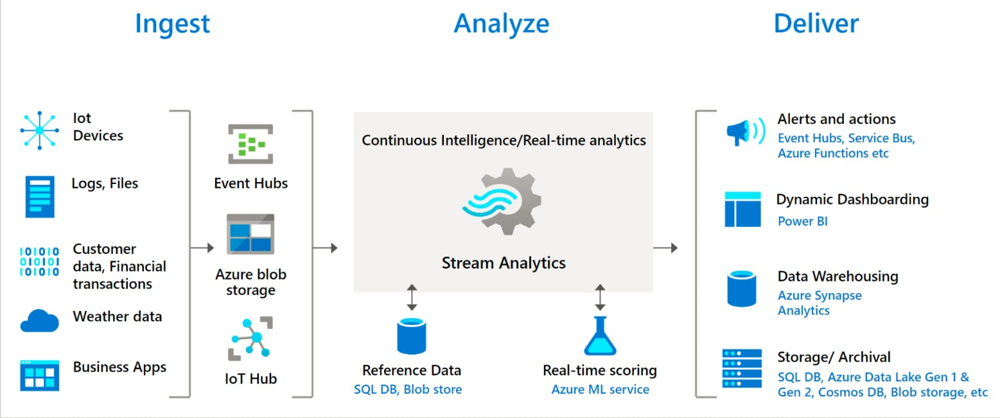

# Real-Time Mega Sale Monitoring on Azure Streaming Analytics

> Vietnamese course README: [README.md](README.md). Status: in progress (target: 2026-12-01).

## Problem

During Mega Sale events on e-commerce platforms (Tiki, Shopee, Lazada), an electronics brand selling on all three needs to see within seconds how sales are going and whether something is wrong. This project builds a real-time monitoring center for that brand.

It answers two kinds of questions:

- **Business:** GMV, orders per minute, view → cart → purchase funnel, top products, breakdown by platform and province.
- **Fraud and incidents**, detected by exactly four rules:

| # | Rule | Stream Analytics technique |
|---|---|---|
| 1 | Bot buying: one user places more than N orders in 1 minute | Window + `COUNT` per user |
| 2 | Voucher hunting: one `device_id` tied to many new accounts | `COUNT(DISTINCT)` in a window |
| 3 | Price mismatch against a reference price | `JOIN` with reference data (`price_list`) |
| 4 | Abnormal spike or dip in orders per minute | `AnomalyDetection_SpikeAndDip` |

**Data.** Real shopping behavior from the REES46 dataset (November 2019, 67.5M events, 3.7M users, 190K products), replayed as a live stream. The replay adds seeded Vietnam context (platform, province, payment method) and injects **labeled** fraud scenarios (`is_fraud`, `scenario`), so detection quality can be measured with precision and recall. Events are deliberately delayed (`is_late`) to prove processing by event time, not arrival time.

**Output.** Power BI for business users (real-time dashboard, historical report with row-level security per platform and region) and Grafana for operations (war room, alerting).

## Architecture



*Reference diagram from Microsoft; a project-specific diagram will replace it.*

```
REES46 ─► Producer (Kafka API) ─► Event Hubs ─► Stream Analytics ─┬─► Power BI (real-time)
          dev: Kafka in Docker                       ▲             ├─► ADLS Gen2 (Parquet) ─► Synapse serverless ─► Power BI (history, RLS)
                                              reference data       ├─► Azure SQL DB ─► Grafana (alerting)
                                                                   └─► Azure Function ─► Discord / Telegram
Terraform (remote state) · GitHub Actions (OIDC) · all queries and configs live in Git
```

## Tech stack

| Layer | Technology | Purpose |
|---|---|---|
| Producer | Python 3.12, Kafka API | Replays REES46 with event-time shifting, speed control, late events and injected fraud |
| Ingestion | Azure Event Hubs (Standard) | Buffers the stream; Kafka-compatible endpoint, 4 partitions |
| Processing | Azure Stream Analytics | Windowed KPIs, 4 fraud rules, reference-data joins, anomaly detection |
| Storage | ADLS Gen2 (Parquet) | Raw archive and aggregated outputs |
| Analytics | Synapse serverless SQL | Queries the lake for the historical report (pay per TB scanned) |
| Serving | Azure SQL DB (free offer), Grafana | Aggregates for the ops dashboard and alerting |
| BI | Power BI (PBIP in Git) | Real-time dashboard, historical report, row-level security |
| Alerts | Azure Functions | Pushes fraud alerts to Discord / Telegram |
| IaC | Terraform (`azurerm`, `azapi`) | Reproducible infra; state in Azure Blob with versioning and lock |
| CI/CD | GitHub Actions (OIDC) | `ruff`, `pytest`, `terraform validate/plan`; no stored secrets |
| Local dev | Docker (Kafka), DuckDB, Parquet | Test without Azure cost; fast data exploration |

## Results so far

Measured on the real data, not estimated:

- **Dataset:** 67.5M events, 3.7M users, 190K products; `purchase` is 1.4% of events; 100,519 duplicate rows found and removed.
- **Real traffic patterns:** peak sale on 15–17 Nov 2019 (17 Nov: 185K purchases, about 8× a normal day). Two real outage windows with zero purchases (14 Nov 18:00 → 16 Nov 08:00 UTC and 16 Nov 16:00 → 17 Nov 03:00 UTC) while view and cart events continued; these are test cases for rule 4.
- **Throughput:** original average 26.5 events/s, peak 243 events/s; one Event Hubs throughput unit (1,000 events/s) supports up to about 4× replay speed.
- **Rule baselines:** 99.7% of user-minutes contain at most 1 purchase (max 7), which informs the rule 1 threshold; price spread max/min is 1.33 at p95 and 1.67 at p99, which informs rule 3.
- **Query speed:** the same query takes 59.7 s on CSV.gz and 0.96 s on Parquet (DuckDB), about 62× faster.
- **Producer → Event Hubs** over the Kafka API verified with 0 errors; producer covered by 27 tests.
- **Cost:** 0.03 USD spent so far (budget alert at 30 USD/month); Stream Analytics and Event Hubs are stopped or destroyed after each test session.
- **Fraud detection precision/recall:** _to be added after the end-to-end run._

### Screenshots

_Real-time dashboard: to be added._

_Historical report: to be added._

_Grafana war room: to be added._

## Engineering practices

- Infrastructure as code with Terraform; Synapse and SQL use Entra ID only (no passwords).
- GitHub Actions authenticates to Azure with OIDC (federated credentials, no client secret). The plan job fails if it would destroy or replace a resource.
- `main` is protected: changes go through pull requests with required checks (`lint-test`, `tf-validate`) and per-folder `CODEOWNERS` review.
- Data contract documented in [docs/event-schema.md](docs/event-schema.md).

## Team

Team of four. Son led the project and owns the architecture, Terraform infrastructure, CI/CD, Stream Analytics queries and repository workflow.

| Member | GitHub | Main area |
|---|---|---|
| Pham Nguyen Thanh Son | [@ThSonDev](https://github.com/ThSonDev) | Lead: architecture, infra, CI/CD, ASA queries |
| Tran Tuan Minh | [@TunMinhh](https://github.com/TunMinhh) | Producer: replay, late events, tests |
| Vu Ngoc Bao Thang | [@vngbthang](https://github.com/vngbthang) | Stream Analytics outputs and late-event policy |
| Pham Nguyen Anh Tuan | [@PNAnhTuan](https://github.com/PNAnhTuan) | Power BI |

## Data and attribution

REES46, *eCommerce behavior data from multi category store*: [Kaggle](https://www.kaggle.com/datasets/mkechinov/ecommerce-behavior-data-from-multi-category-store), [REES46](https://rees46.com). Download steps: [data/README.md](data/README.md). Vietnam enrichment (platform, province, payment) and fraud scenarios are synthetic and seeded.

## Course information

University of Information Technology (UIT), VNU-HCM. Course IS402.R11, Cloud Computing. Instructor: M.Sc. Ha Le Hoai Trung.
