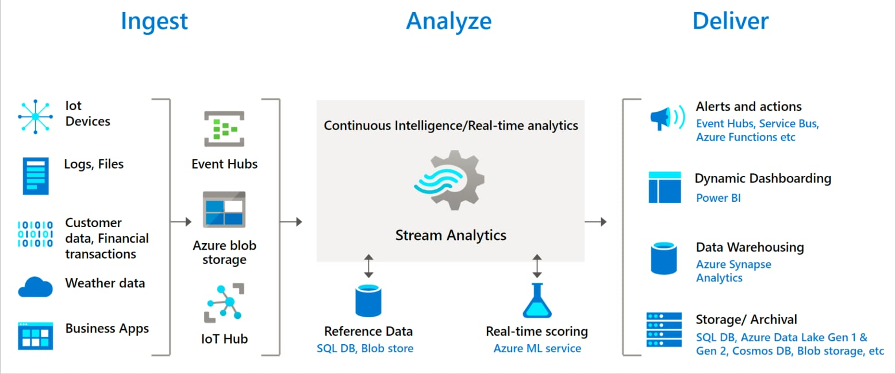

# IS402.R11 - Điện toán đám mây

* **Giảng viên hướng dẫn:** ThS. Hà Lê Hoài Trung
* **Đề tài:** Bài tập 04: Phân tích dữ liệu luồng và trực quan kết quả lên Power BI / dữ liệu đơn hàng trong các hệ thống thương mại điện tử lớn như Tiki, Shopee, Lazada, …

## Danh sách thành viên
| STT | MSSV | Họ và tên | GitHub | Vai trò / Nhiệm vụ |
| :---: | :---: | :--- | :--- | :---: |
| 1 | 23521360 | Phạm Nguyễn Thanh Sơn | [@ThSonDev](https://github.com/ThSonDev) | Lead |
| 2 | 23520959 | Trần Tuấn Minh | [@TunMinhh](https://github.com/TunMinhh) | *** |
| 3 | 23521435 | Vũ Ngọc Bảo Thắng | [@vngbthang](https://github.com/vngbthang) | *** |
| 4 | 23521726 | Phạm Nguyễn Anh Tuấn | [@PNAnhTuan](https://github.com/PNAnhTuan) | *** |

## Nội dung đề tài
* **Điều kiện:** Python
* **Mô tả:** Xây dựng **trung tâm giám sát Mega Sale real-time** cho một thương hiệu điện tử bán đa sàn (Tiki, Shopee, Lazada). Luồng đơn hàng được phát lại từ dữ liệu hành vi mua sắm thật (REES46, tháng 11/2019, 67.5 triệu event), làm giàu bối cảnh Việt Nam (sàn, tỉnh thành, phương thức thanh toán) và chèn các kịch bản gian lận có nhãn. Azure Stream Analytics xử lý luồng để:
  * Theo dõi kinh doanh: GMV, số đơn theo phút, phễu xem → giỏ → mua, top sản phẩm, so sánh theo sàn và tỉnh.
  * Phát hiện gian lận và sự cố bằng 4 luật: bot gom hàng, một thiết bị nhiều tài khoản săn voucher, sai giá so với giá niêm yết, số đơn tăng/giảm bất thường.
  * Trực quan kết quả: Power BI (dashboard real-time + báo cáo lịch sử có phân quyền theo sàn/miền, xem được trên mobile) và Grafana (giám sát vận hành, cảnh báo).
* **Yêu cầu:**
  * Event Hubs
  * Azure Blob Storage
  * Stream Analytics
  * Power BI service
  * Azure Synapse Analytics
* **Công nghệ bổ sung:** Azure Functions, Azure SQL Database, Grafana, Kafka (Docker, môi trường dev), Terraform, GitHub Actions.

## Dữ liệu
* REES46 – *eCommerce behavior data from multi category store*: [Kaggle](https://www.kaggle.com/datasets/mkechinov/ecommerce-behavior-data-from-multi-category-store), [REES46](https://rees46.com). Cách tải xem [data/README.md](data/README.md).

## Tài liệu tham khảo
* https://learn.microsoft.com/en-us/azure/stream-analytics/stream-analytics-real-time-fraud-detection
* https://github.com/Azure/azure-stream-analytics/tree/master/DataGenerators/TelcoGeneratorCore
* https://learn.microsoft.com/en-us/azure/stream-analytics/quick-create-visual-studio-code
* https://learn.microsoft.com/en-us/azure/stream-analytics/stream-analytics-quick-create-portal
* https://learn.microsoft.com/en-us/azure/architecture/solution-ideas/articles/demand-forecasting
