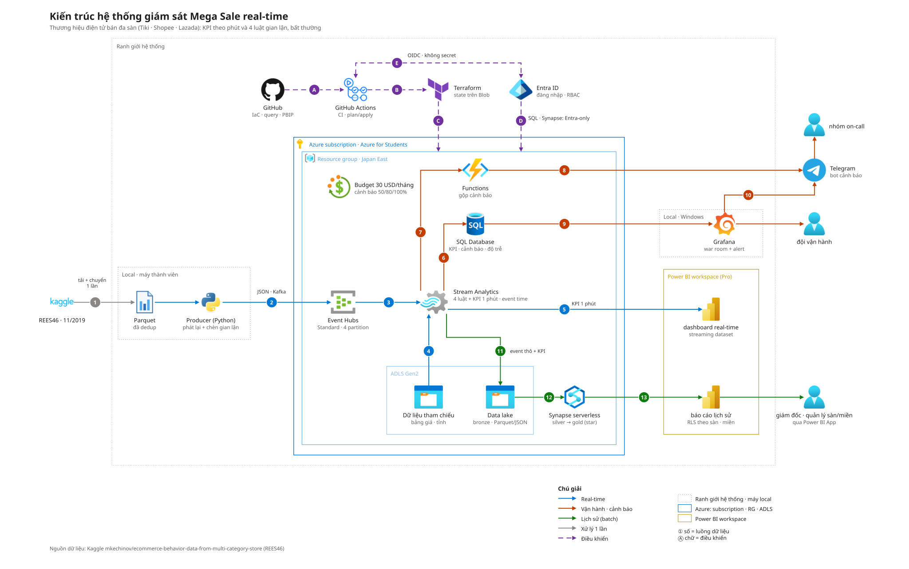

# Kiến trúc tổng thể

Trung tâm giám sát Mega Sale real-time cho thương hiệu điện tử bán đa sàn (Tiki, Shopee, Lazada): KPI kinh doanh theo phút và 4 luật gian lận, bất thường.



Nguồn chỉnh sửa: [`architecture.drawio.svg`](architecture.drawio.svg) là SVG có nhúng sẵn dữ liệu draw.io, mở thẳng bằng draw.io để sửa (không cần file `.drawio` riêng). Muốn xuất PNG:

```powershell
& "C:\Program Files\draw.io\draw.io.exe" -x -f png -b 20 -s 2 -o docs/architecture.png docs/architecture.drawio.svg
# Linux: drawio -x -f png -b 20 -s 2 -o docs/architecture.png docs/architecture.drawio.svg
```

Cách đọc hình: khung ngoài (nét chấm) là ranh giới hệ thống; Kaggle, 3 nhóm người dùng và Telegram nằm ngoài khung. Azure subscription, resource group, ADLS Gen2 (vẽ 2 container dùng trong luồng) và workspace Power BI (khung vàng) là các khung chứa thật. Số trong vòng tròn là luồng dữ liệu (nét liền), chữ A–E là điều khiển (nét đứt tím).

## 4 luật (chạy trong Stream Analytics)

1. Bot gom hàng: 1 user > N đơn / 1 phút (window + `COUNT` theo user).
2. Săn voucher: 1 `device_id` ↔ nhiều tài khoản mới (`COUNT(DISTINCT)` trong window).
3. Sai giá so với giá tham chiếu (JOIN reference data `price_list`).
4. Số đơn/phút tăng hoặc giảm bất thường (`AnomalyDetection_SpikeAndDip`).

Cùng job còn tính KPI 1 phút theo sàn × tỉnh (view, cart, purchase, đơn, GMV). Job dùng `TIMESTAMP BY event_time`, chịu event đến trễ và sai thứ tự 60 s (late arrival / out-of-order), query nằm trong Git (`stream/query.asaql`).

## Luồng dữ liệu (số, nét liền)

Real-time (xanh dương)

1. (xám, chạy 1 lần, xử lý trước) Tải bộ REES46 từ Kaggle (11/2019, 67.5 triệu event), `scripts/prepare_data.py` dedup và chuyển thành Parquet. Đây không phải luồng stream từ Kaggle. Producer đọc Parquet mỗi lần chạy (mũi tên xanh dương, không số).
2. Producer (Python, chạy trên máy) đọc Parquet, phát lại theo nhịp giờ gốc, `event_time` = giờ gửi (`--speed` ≤ 4), làm giàu dữ liệu VN có seed, chèn 4 kịch bản gian lận có nhãn (`is_fraud`) và event trễ (`is_late`). Gửi JSON bằng Kafka protocol qua TLS (cổng 9093), key = `user_id`, tới Event Hubs `evhns-megasale-dev`.
3. Event Hubs hub `events` (Standard 1 TU, 4 partition). Stream Analytics đọc bằng consumer group `asa`.
4. Dữ liệu tham chiếu `price_list.csv` (189,284 sản phẩm) và `provinces.csv` (34 tỉnh) nằm ở container `reference`, Terraform upload từ Git; ASA JOIN khi chạy luật sai giá và gom theo tỉnh.
5. Output `kpi_1min_powerbi` (KPI 1 phút) đẩy sang Power BI streaming dataset (dashboard real-time).

Vận hành và cảnh báo (cam)

6. Output `kpi_1min_sql`, `pipeline_latency`, `alerts` → bảng `dbo.kpi_1min`, `dbo.pipeline_latency`, `dbo.alerts` trong Azure SQL Database, ghi bằng managed identity (Entra-only).
7. `alerts` của 4 luật gửi sang Azure Functions (`func-megasale-dev`).
8. Function gộp cảnh báo (Telegram giới hạn 20 tin/phút/nhóm) rồi gọi `sendMessage` tới nhóm on-call.
9. Grafana chạy local (Windows) đọc SQL bằng Entra app chỉ đọc (`grafana-megasale-reader`); dashboard provision từ Git. Đội vận hành xem war room trên Grafana (mũi tên không đánh số).
10. Alert rule của Grafana dùng chung bot Telegram. Telegram gửi tới nhóm on-call (mũi tên không đánh số).

Lịch sử (xanh lá)

11. ASA ghi event thô `raw_archive` (Parquet, lớp bronze) và `kpi_1min` (JSON) vào container `lake` (Data lake) (`<output>/yyyy/MM/dd/HH`).
12. Synapse serverless SQL đọc Parquet: view silver, rồi star schema gold (`fact_events` + `dim_date`, `dim_product`, `dim_channel`, `dim_province`, `dim_payment`).
13. Power BI đọc lớp gold cho báo cáo lịch sử ≥ 4 trang, RLS theo sàn và miền (RLS chỉ áp cho Viewer). Báo cáo được publish qua Power BI App cho giám đốc, quản lý sàn, quản lý miền (mũi tên cuối không đánh số).

## Điều khiển (chữ A–E, nét đứt tím)

- **A.** Mọi thứ là code trong Git: Terraform, ASA query, SQL, PBIP, Grafana dashboard.
- **B.** GitHub Actions: `ci.yaml` (ruff, pytest, terraform validate) và `terraform.yaml` (plan, apply, destroy-eventhubs, destroy) chạy Terraform.
- **C.** Terraform (azurerm + azapi) dựng mọi resource trong `rg-megasale-dev` (RG và role Azure cấp tay); state ở Blob `stmegasaletf2911` (versioning + khóa xóa).
- **D.** Entra ID: SQL và Synapse chỉ đăng nhập Entra. Event Hubs (producer, ASA) dùng SAS; ASA → Storage dùng account key; ASA → SQL, Power BI qua managed identity.
- **E.** GitHub Actions → Entra ID: Actions gửi OIDC token, nhận lại access token (federated credential của app `gh-actions-is402`), không dùng secret.
- Budget 30 USD/tháng (`budget-megasale`, cảnh báo 50/80/100%) gắn với resource group: Event Hubs destroy khi rảnh, ASA stop sau buổi test.

## Số đo và nguồn dữ liệu

Số đo thực: 67.5 triệu event, trung bình 26.5 event/s, đỉnh 243 event/s. Test E2E 17/11: 76,790 event (3,803 trễ), KPI khớp raw 16/16 phút, gửi → ASA ~476 ms.

Nguồn dữ liệu: Kaggle `mkechinov/ecommerce-behavior-data-from-multi-category-store` (REES46).
