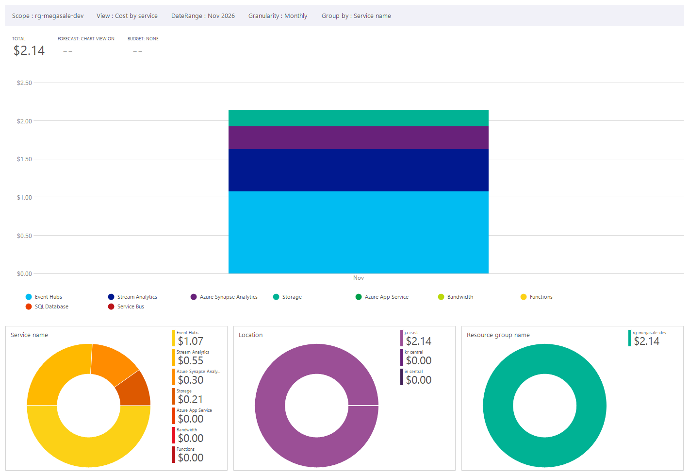
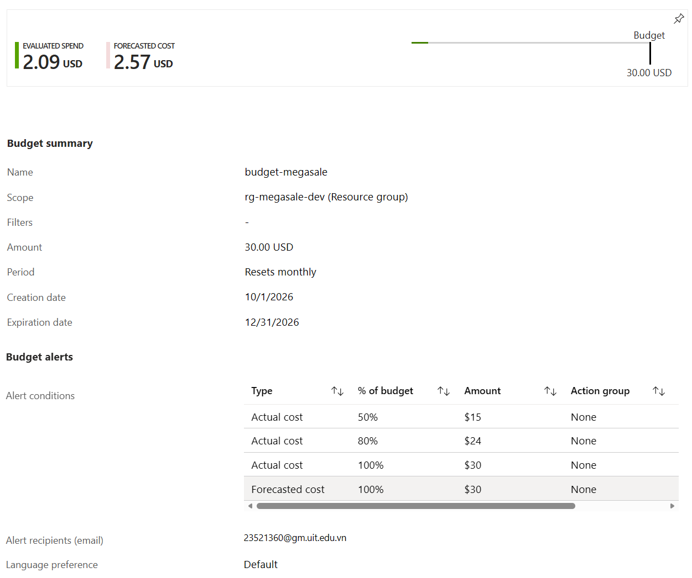
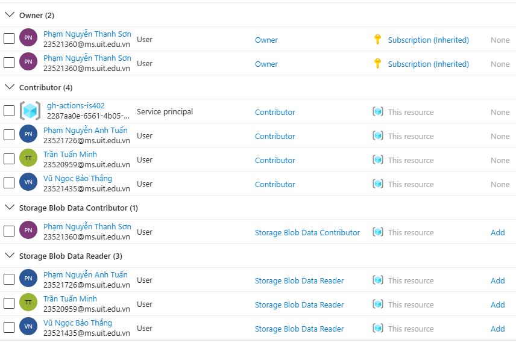
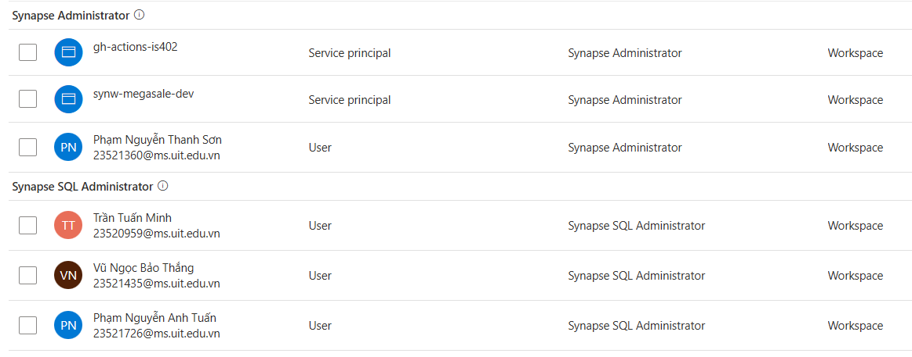
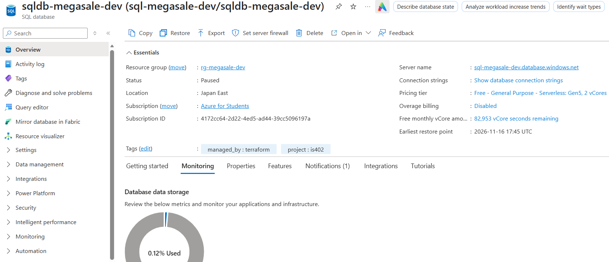
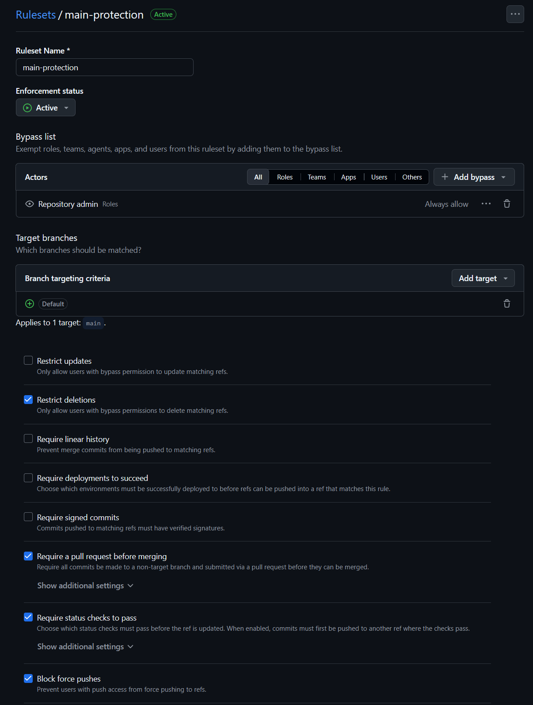
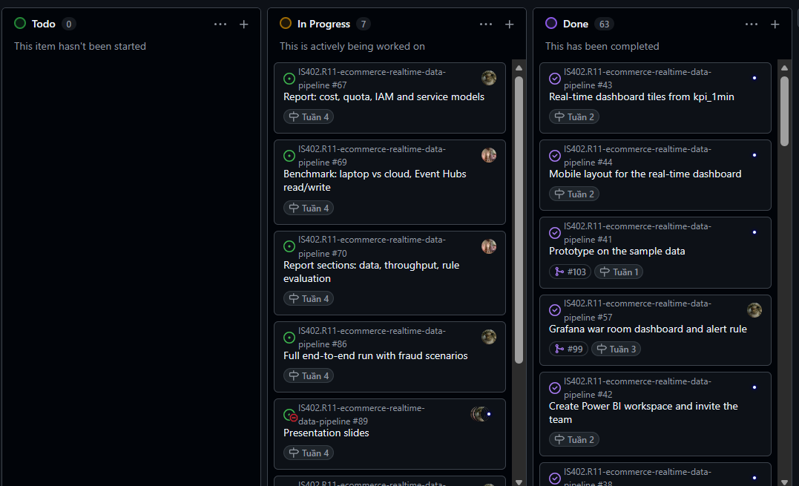

# Phần báo cáo của Sơn

Các mục theo PLAN.md mục 6 (issue #67): dịch vụ theo mô hình IaaS / PaaS / FaaS / SaaS (phần 1), chi phí và quota, phân quyền (IAM), quản lý dự án (phần 5). Số liệu lấy ngày 21/11/2026; lệnh tạo ra từng số nằm ở Phụ lục.

## 1. Dịch vụ theo mô hình IaaS / PaaS / FaaS / SaaS

| Thành phần | Nhóm | Vai trò trong hệ thống | Lý do xếp nhóm |
|---|---|---|---|
| Azure Event Hubs (Standard, 1 TU) | PaaS | Nhận event từ producer qua Kafka API, giữ luồng cho Stream Analytics đọc | Azure vận hành broker, ta chỉ cấu hình hub, partition, consumer group |
| Azure Stream Analytics (V2, 1/3 SU) | PaaS | Chạy query theo cửa sổ thời gian: KPI, luật gian lận, đo độ trễ | Engine xử lý luồng do Azure quản lý, ta chỉ viết query |
| ADLS Gen2 (`stmegasaledev`) | PaaS | Data lake: `reference`, `lake` (Parquet / JSON), `synapse` | Dịch vụ lưu trữ do Azure quản lý |
| Synapse serverless SQL | PaaS | Truy vấn file Parquet trong lake, tạo view cho Power BI | Không có máy chủ riêng, tính tiền theo dữ liệu quét |
| Azure SQL Database (free offer) | PaaS | Bảng `kpi_1min`, `pipeline_latency`, `alerts` cho Grafana | CSDL do Azure quản lý, tự pause khi hết hạn mức |
| Azure Functions (Consumption) | FaaS | `fraud_alert`: gộp cảnh báo và gửi Telegram | Chỉ nộp hàm, tính tiền theo lần chạy |
| Power BI service | SaaS | Dashboard real-time và báo cáo lịch sử, RLS | Dùng sẵn trên web, không quản lý hạ tầng |
| Microsoft Entra ID | SaaS | Đăng nhập, RLS theo người, app `gh-actions-is402` (OIDC), app của Grafana | Dịch vụ định danh có sẵn của Microsoft |
| GitHub (repo, Actions, Projects) | SaaS | Mã nguồn, CI, deploy Terraform, issue và kanban | Dịch vụ dùng qua web |
| Telegram Bot API | SaaS | Nhận tin cảnh báo | Dịch vụ nhắn tin bên ngoài, gọi bằng HTTPS |
| Azure Blob (state Terraform, `stmegasaletf2911`) | PaaS | Lưu `megasale.tfstate`, có versioning và khóa xóa | Cùng loại dịch vụ lưu trữ với ADLS |
| Cost Management và Budget | SaaS | Theo dõi chi phí, cảnh báo 50 / 80 / 100% | Công cụ quản trị có sẵn trên portal |
| Terraform | Công cụ (không phải dịch vụ cloud) | Khai báo hạ tầng; chạy trên máy hoặc runner GitHub | Phần mềm chạy ở máy người dùng, ghi state lên Blob |
| Grafana OSS (Windows service, máy Sơn) | Ngoài 4 nhóm | War room ops, đọc Azure SQL | Phần mềm tự cài và tự vận hành trên máy cá nhân, không chạy trên cloud |

**Không có IaaS.** Đồ án không tạo máy ảo, Kubernetes hay Databricks (PLAN.md mục 5 và CLAUDE.md "Không dùng"): mọi thành phần chạy trên dịch vụ Azure quản lý sẵn nên không phải vá OS hay dựng máy chủ.

Các chỗ xếp nhóm còn tranh cãi:

- **Synapse serverless:** gần FaaS ở cách tính tiền (theo lượng dữ liệu quét, không có tài nguyên chạy thường trực), nhưng là engine truy vấn do Azure quản lý, nên xếp PaaS.
- **Event Hubs:** namespace bật lên là tính tiền theo giờ (khác Functions), nên xếp PaaS dù cũng "serverless" về mặt vận hành.
- **ADLS Gen2:** một số tài liệu xếp lưu trữ vào IaaS (storage), ở đây xếp PaaS vì ta không quản lý đĩa hay máy chủ, chỉ dùng API và quyền truy cập.
- **Grafana:** chạy dạng Windows service trên máy Sơn, không có dịch vụ cloud tương ứng trong dự án.

## 2. Chi phí thật

Nguồn: Cost Management, phạm vi resource group `rg-megasale-dev`, ActualCost từ 01/11 đến 21/11/2026, đơn vị USD. Số này **trễ 8–24 giờ**, nên buổi test sáng 21/11 (alerts #85, `destroy-eventhubs` xong sáng cùng ngày) chưa có trong đó.

**Tổng: 1.21 USD (1.205882), bằng 4.0% budget `budget-megasale` 30 USD/tháng** (còn 28.79 USD).

Theo dịch vụ:

| Dịch vụ | USD | Tỷ lệ |
|---|---:|---:|
| Event Hubs | 0.956 | 79.3% |
| Stream Analytics | 0.217 | 18.0% |
| Storage | 0.017 | 1.4% |
| Synapse | 0.016 | 1.3% |
| SQL Database, Functions, App Service, Bandwidth, Service Bus | 0.000 | 0% |

Theo meter (các dòng đáng kể):

| Dịch vụ | Meter | USD |
|---|---|---:|
| Event Hubs | Standard Throughput Unit | 0.900 |
| Event Hubs | Standard Ingress Events | 0.056 |
| Stream Analytics | Standard V2 Streaming Unit/Job | 0.217 |
| Synapse | Standard Data Processed | 0.016 |
| Storage | Hot Read Operations | 0.010 |
| SQL Database | 1 vCore - Free; General Purpose Data Stored - Free | 0.000 |
| Functions | Standard Execution Time | 0.000 |

Đối chiếu với bảng giá japaneast (Azure Retail Prices API, 20/10/2026):

- Event Hubs: 0.900 USD ÷ 0.03 USD/TU/giờ = **30 TU-giờ** (Event Hubs tồn tại 30 giờ cộng dồn); ingress 0.056 USD tương ứng 0.028 USD / 1 triệu event, khoảng 2 triệu event.
- Stream Analytics: 0.217 USD ÷ ~0.155 USD/giờ ≈ **1.4 giờ chạy** (suy ra từ giá, không đo trực tiếp).
- Synapse serverless 0.016 USD ở giá 6 USD/TB tương ứng khoảng 2.6 GB quét (suy ra).

Theo ngày (USD, làm tròn 3 chữ số; ngày không ghi là dưới 0.001):

| Ngày | 03/11 | 14/11 | 15/11 | 16/11 | 17/11 |
|---|---:|---:|---:|---:|---:|
| Chi phí | 0.030 | 0.079 | 0.495 | 0.426 | 0.176 |

Bốn ngày 14–17/11 chiếm 1.175 USD, tức 97.4% tổng. Đây là các ngày chạy test e2e và sự cố bên dưới.

**SQL free offer.** Mỗi database được 100,000 vCore-giây và 32 GB dữ liệu mỗi tháng; khi hết hạn mức ở chế độ auto-pause, database tạm ngưng đến đầu tháng sau và không bị tính tiền ([Microsoft Learn, free offer](https://learn.microsoft.com/azure/azure-sql/database/free-offer)). Metric `free_amount_remaining` còn **91,793 vCore-giây** ở mốc 06:39 UTC ngày 21/11 (đã dùng khoảng 8.2% hạn mức tháng; chưa tính buổi test sau đó và các lần truy vấn kiểm tra).

**Bài học chi phí.**

- 15–16/11: chạy `apply` qua CI rồi quên tắt, Event Hubs sống 26.5 giờ (khoảng 0.80 USD, hai phần ba hóa đơn tháng). Với giá hiện tại, Stream Analytics để chạy cả tuần sẽ tốn khoảng 26 USD, nên đây là rủi ro lớn hơn.
- Quy trình buổi test đã đặt ra: `apply` → `fill_env.py` → kiểm grant SQL → start ASA → test → **stop ASA trước** → `destroy-eventhubs`; sau đó kiểm 3 điều: `az eventhubs namespace list -g rg-megasale-dev` rỗng, ASA `Stopped`, service Grafana `Stopped`. Buổi test 21/11 theo đúng quy trình này và cả 3 kiểm tra đều đạt.
- Giữ lại các resource không tốn tiền khi rảnh (Functions, SQL free, Synapse serverless, storage); chỉ Event Hubs và ASA bị bật / tắt.

## 3. Quota và giới hạn đã chạm hoặc phải tính tới

| Giới hạn | Giá trị | Ảnh hưởng tới dự án | Nguồn |
|---|---|---|---|
| Event Hubs Standard, 1 throughput unit | Ingress 1 MB/giây hoặc 1,000 event/giây (cái nào tới trước); egress 2 MB/giây hoặc 4,096 event/giây | Producer giữ `--speed` ≤ 4 (tốc độ gốc đỉnh 243 event/giây × 4 ≈ 972 event/giây) | [Event Hubs scalability](https://learn.microsoft.com/azure/event-hubs/event-hubs-scalability), [quotas](https://learn.microsoft.com/azure/event-hubs/event-hubs-quotas) |
| Stream Analytics: reader trên mỗi partition mỗi consumer group | 5 | Mỗi `FROM [events]` là một reader nên query đọc input một lần trong `WITH ev` | [Troubleshoot input connections](https://learn.microsoft.com/azure/stream-analytics/stream-analytics-troubleshoot-input) |
| Stream Analytics V2: streaming unit | API V2 nhận SU × 10, tối thiểu 3 (1/3 SU) | Job dùng 3; giá trị thấp hơn bị API từ chối lúc `apply` | Quan sát lúc `apply` (CLAUDE.md, mục Kinh nghiệm) |
| Azure SQL free offer | 100,000 vCore-giây và 32 GB dữ liệu mỗi tháng | Grafana không để chạy thường trực, dừng service sau buổi để DB tự pause | [Microsoft Learn](https://learn.microsoft.com/azure/azure-sql/database/free-offer) |
| Telegram bot trong group | Không quá 20 tin mỗi phút | Function gộp cảnh báo thành một tin cho cả lô và chặn lặp 10 phút | [Telegram Bots FAQ](https://core.telegram.org/bots/faq) |
| Region của Azure for Students | `japaneast`, `japanwest`, `koreacentral`, `centralindia`, `indonesiacentral` | Chặn sẵn trong `infra/variables.tf` | Policy của subscription (PLAN.md mục 5) |
| Power BI Pro trial | Đến khoảng 18/12/2026 | Phải demo trước ngày này | Trial của Sơn (CLAUDE.md) |

Không dùng quota vCPU theo region (`az vm list-usage`) vì dự án không tạo máy ảo.

## 4. IAM: ai có quyền gì ở đâu

Quyền Azure (Azure RBAC), lấy bằng `az role assignment list`:

| Phạm vi | Người / app | Role |
|---|---|---|
| Subscription | Sơn | Owner |
| Resource group `rg-megasale-dev` | Minh, Thắng, Tuấn, app `gh-actions-is402` (CI) | Contributor |
| Resource group | Minh, Thắng, Tuấn | Storage Blob Data Reader |
| Resource group | Sơn | Storage Blob Data Contributor |
| Container `lake` | Thắng | Storage Blob Data Contributor (cho CETAS #92) |
| Storage state `stmegasaletf2911` | Sơn, app `gh-actions-is402` | Storage Blob Data Contributor |

Tổng cộng 8 role assignment ở mức resource group, 1 ở container `lake`, 2 ở storage state, 1 ở subscription. App CI chỉ là Contributor nên không tạo được role assignment; mọi role Azure của người và managed identity được cấp tay ở mức resource group.

Synapse RBAC (data plane, `az synapse role assignment list`, 6 assignment):

| Người / identity | Role |
|---|---|
| Sơn | Synapse Administrator |
| Minh, Thắng, Tuấn | Synapse SQL Administrator |
| Identity của workspace `synw-megasale-dev` (service principal) | Synapse Administrator |
| App CI `gh-actions-is402` (service principal, người tạo workspace qua Terraform) | Synapse Administrator |

Hai dòng cuối không do `synapse.tf` khai báo (Terraform chỉ cấp 4 dòng đầu): Synapse tự cấp Synapse Administrator cho identity của workspace và cho người tạo workspace, ở đây là app CI. Đối chiếu bằng `az ad sp show --id <client ID của gh-actions-is402> --query id`.

User trong Azure SQL Database `sqldb-megasale-dev` (Entra-only, `sys.database_principals`):

| User | Quyền |
|---|---|
| Minh, Thắng, Tuấn (`@ms.uit.edu.vn`) | `db_owner` |
| `grafana-megasale-reader` (app Entra) | `db_datareader` |
| `asa-megasale-dev` (managed identity của job ASA) | Không có role cố định; `SELECT, INSERT` trên `kpi_1min`, `pipeline_latency`, `alerts` (`scripts/sql/grant_asa_output_permissions.sql`) |
| Sơn | Admin Entra của SQL server |

Quyền khác: Power BI workspace `Megasale-powerBI` có Sơn và Tuấn là Admin, identity của ASA là Contributor (theo `infra/README.md`, chưa kiểm lại ở lần lấy số này). Event Hubs có hai policy tách biệt: `producer-send` chỉ gửi, `asa-listen` chỉ đọc.

Nguyên tắc áp dụng:

- **Entra-only:** SQL Database và Synapse không có mật khẩu SQL; ASA ghi vào SQL bằng managed identity.
- **OIDC, không secret:** GitHub Actions đăng nhập bằng federated credential (`gh-main`, `gh-pr`, dạng immutable subject), app CI không có client secret.
- **Least privilege:** producer chỉ có quyền gửi, Grafana chỉ đọc (`db_datareader`), app CI không tạo được role, thành viên chỉ có quyền đọc data lake (riêng Thắng ghi vào một container).
- **Secret chỉ ở `.env`** (gitignored) và app settings; không đi qua chat, không vào Git.
- **Ngoại lệ có chủ đích:** (1) app `grafana-megasale-reader` có client secret hạn đến 31/12/2026, vì Grafana chạy local nên không dùng được Managed Identity; (2) firewall SQL và Synapse mở mọi IP vì IP nhà thành viên thay đổi, bù lại chỉ cho đăng nhập Entra ID.

## 5. Quản lý dự án

Số liệu GitHub lấy ngày 21/11/2026.

| Milestone | Hạn | Issue đã đóng | Issue còn mở |
|---|---|---:|---:|
| Tuần 1 | 02/11 | 20 | 1 |
| Tuần 2 | 09/11 | 17 | 2 |
| Tuần 3 | 16/11 | 9 | 4 |
| Tuần 4 | 23/11 | 2 | 15 |
| **Tổng** | | **48** | **22** |

Tổng 70 issue. Issue trễ giữ nguyên milestone cũ làm bằng chứng tiến độ, không dời.

Issue theo người phụ trách (một issue có thể có nhiều người):

| Người | Đã đóng | Còn mở |
|---|---:|---:|
| Sơn | 21 | 8 |
| Minh | 14 | 4 |
| Thắng | 9 | 6 |
| Tuấn | 4 | 8 |

Pull request: 29, trong đó 28 đã merge và 1 đóng không merge. PR đã merge theo tác giả: Sơn 14, Thắng 8, Minh 5, Tuấn 1. Review trên PR: 14 lượt approve và 5 lượt yêu cầu sửa (đều của Sơn, người duyệt dự phòng của mọi thư mục), 1 lượt comment của Thắng.

Quy trình:

- **Issue:** mỗi issue có người phụ trách, milestone, "Chờ: #n" (gắn bằng GitHub "blocked by") và "Xong khi". PR ghi `Closes #n`.
- **Kanban:** GitHub Project số 1 (`is402-ecom-mega-sale`) theo dõi trạng thái.
- **CODEOWNERS:** mỗi thư mục có chủ và Sơn dự phòng; thư mục của Sơn thì Minh là người duyệt dự phòng.
- **Ruleset `main-protection` (đang bật):** không commit thẳng vào `main`, PR cần 1 approve, bắt buộc hai check `lint-test` và `tf-validate`, chặn xóa và force push. Vai trò admin có thể bypass, chỉ dùng khi khẩn cấp.
- **Review là kiểm chứng:** người duyệt chạy lại test, chạy lại script so kết quả, chạy `terraform plan` thật, không tin số trong mô tả PR. Workflow `terraform.yaml` chạy plan trên PR sửa `infra/` và báo đỏ nếu có destroy hoặc replace.
- **Làm chung trên một resource group:** cả 4 người cùng dùng `rg-megasale-dev` với quyền ở mục 4; hạ tầng khai báo bằng Terraform với state chung trên Blob có khóa, không tạo tay.

## Ảnh chụp minh chứng















## Phụ lục: lệnh tạo ra số liệu

Đặt `MSYS_NO_PATHCONV=1` trong Git Bash khi đường dẫn bắt đầu bằng `/subscriptions/...`. Cost Management hay trả 429 thì thử lại.

```powershell
# Chi phí: body {"type":"ActualCost","timeframe":"Custom","timePeriod":{"from":"2026-11-01T00:00:00Z","to":"2026-11-21T23:59:59Z"},"dataset":{"granularity":"None","aggregation":{"totalCost":{"name":"Cost","function":"Sum"}},"grouping":[{"type":"Dimension","name":"ServiceName"}]}}
# Theo meter: thêm {"type":"Dimension","name":"Meter"}; theo ngày: granularity "Daily", grouping []
az rest --method post --url "https://management.azure.com/subscriptions/<sub>/resourceGroups/rg-megasale-dev/providers/Microsoft.CostManagement/query?api-version=2023-11-01" --body "@cost-body.json"

# Budget
az consumption budget show --budget-name budget-megasale --resource-group rg-megasale-dev

# SQL free offer còn lại
az monitor metrics list --resource <id sqldb-megasale-dev> --metric free_amount_remaining --aggregation Minimum --interval PT1H --offset 3h

# IAM
az role assignment list --resource-group rg-megasale-dev
az role assignment list --scope <id stmegasaletf2911>
az role assignment list --all --assignee 23521435@ms.uit.edu.vn
az synapse role assignment list --workspace-name synw-megasale-dev
az synapse role definition list --workspace-name synw-megasale-dev
sqlcmd -S sql-megasale-dev.database.windows.net -d sqldb-megasale-dev --authentication-method ActiveDirectoryAzCli -Q "SELECT p.name, r.name FROM sys.database_principals p LEFT JOIN sys.database_role_members m ON m.member_principal_id=p.principal_id LEFT JOIN sys.database_principals r ON r.principal_id=m.role_principal_id"

# GitHub
gh issue list --state all --limit 300 --json number,state,milestone,assignees
gh pr list --state all --limit 300 --json number,state,author,reviews
gh api repos/ThSonDev/IS402.R11-ecommerce-realtime-data-pipeline/rulesets/<id>
```
