# Phần báo cáo của Tuấn

Mục 4 "Hiện thực" theo PLAN.md mục 6 (issue #76): báo cáo Power BI, dashboard real-time, RLS, chia sẻ, mobile. Bản có sẵn ảnh để ghép Word: `tuan-report.docx` (cùng nội dung). Ảnh của bản này nằm trong `docs/img/`.

## 4.1 Báo cáo lịch sử bốn trang

Báo cáo `megasale-report` đọc dữ liệu từ lược đồ `gold` của Synapse serverless (mô hình sao gồm bảng sự kiện `fact_events` và các bảng chiều ngày, sản phẩm, sàn, tỉnh, thanh toán). Riêng trang 4 đọc thêm bảng `dbo.alerts` từ Azure SQL.

Bảng 4.1: Các trang của báo cáo `megasale-report`

| Trang | Nội dung |
|---|---|
| 1. Tổng quan | GMV, số đơn, giá trị trung bình mỗi đơn, tỷ lệ chuyển đổi; GMV theo ngày và theo sàn |
| 2. Sản phẩm và danh mục | Cơ cấu GMV theo danh mục (bấm xuống cấp 2), top 10 brand, top 10 sản phẩm |
| 3. Sàn và tỉnh | Bản đồ GMV theo tỉnh, bảng GMV theo sàn và miền |
| 4. Gian lận và sự cố | Đơn gian lận, số cảnh báo, bảng cảnh báo, so sánh đơn gian lận (nhãn) với đối tượng bị cảnh báo theo loại |

Điều hướng: mỗi trang có nút chuyển sang ba trang còn lại. Bộ lọc thời gian, sàn và danh mục là slicer dùng chung (Sync slicers) nên chọn một lần thì áp cho mọi trang. Bấm vào một biểu đồ thì các biểu đồ cùng trang lọc theo.

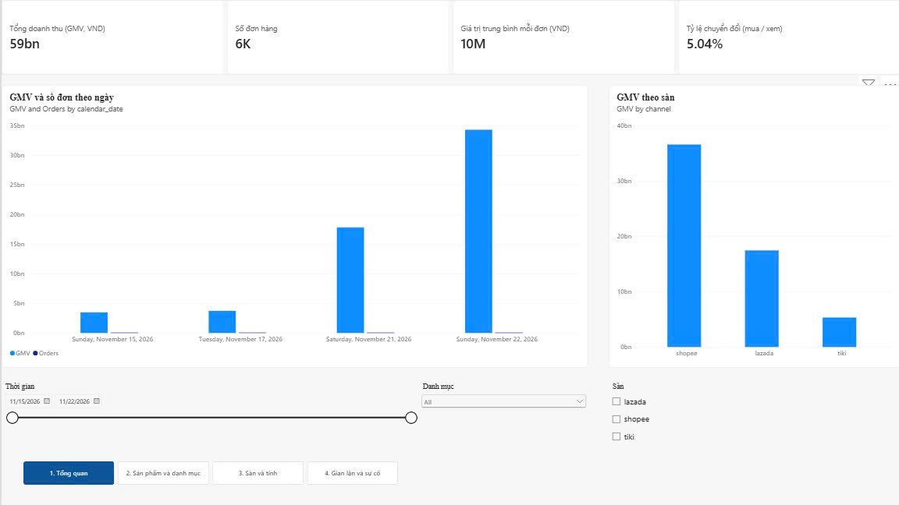

Hình 4.1: Trang 1, Tổng quan

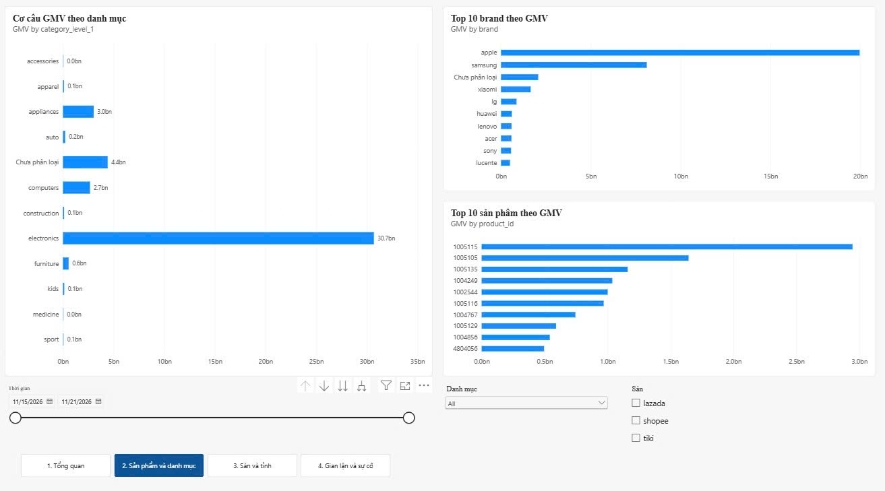

Hình 4.2: Trang 2, Sản phẩm và danh mục

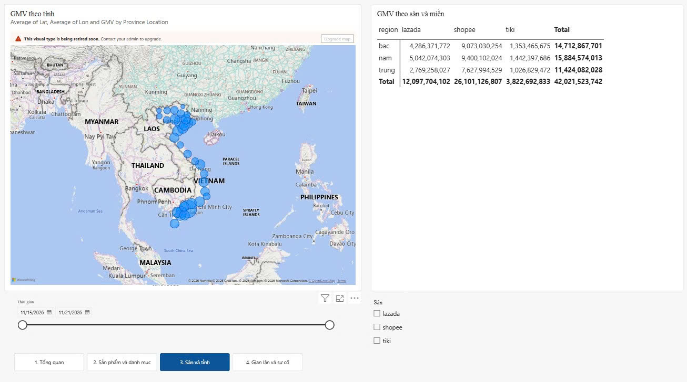

Hình 4.3: Trang 3, Sàn và tỉnh (bản đồ)

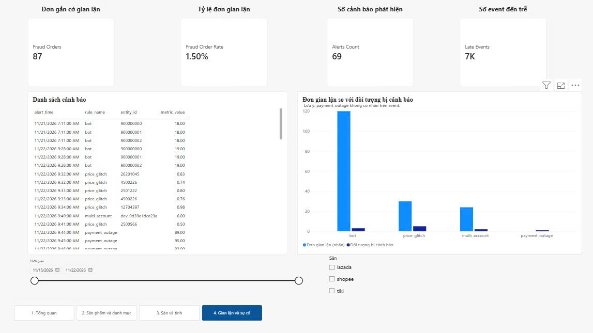

Hình 4.4: Trang 4, Gian lận và sự cố

Lưu ý ở trang 4: `is_fraud` và `scenario` là nhãn đúng (ground truth) do producer sinh ra để chấm điểm, không phải kết quả của bốn luật cảnh báo. Vì vậy biểu đồ so sánh số đơn gian lận theo nhãn với số đối tượng bị cảnh báo theo từng loại (`bot`, `multi_account`, `price_glitch`, `payment_outage`). Bảng `alerts` không có `order_id` nên chỉ so được số lượng theo loại, không so từng đơn. Loại `payment_outage` không gắn nhãn trên từng event nên cột nhãn của loại này để trống.

## 4.2 Dashboard cập nhật thời gian thực

Luồng dữ liệu: producer gửi sự kiện vào Event Hubs, Stream Analytics gom theo cửa sổ 1 phút (theo sàn và tỉnh) rồi ghi vào dataset streaming `megasale_kpi_1min` của Power BI. Mỗi phút có khoảng 100 dòng (sàn nhân tỉnh).

Tile streaming gốc của Power BI chỉ hiện dòng mới nhất, không cộng dồn được. Vì vậy nhóm dựng báo cáo `megasale-realtime` trên dataset này, dùng phép Sum, rồi ghim các biểu đồ lên dashboard "Megasale Realtime". Dashboard có bốn tile: Tổng số đơn, Tổng GMV, Số đơn theo phút và GMV theo sàn.

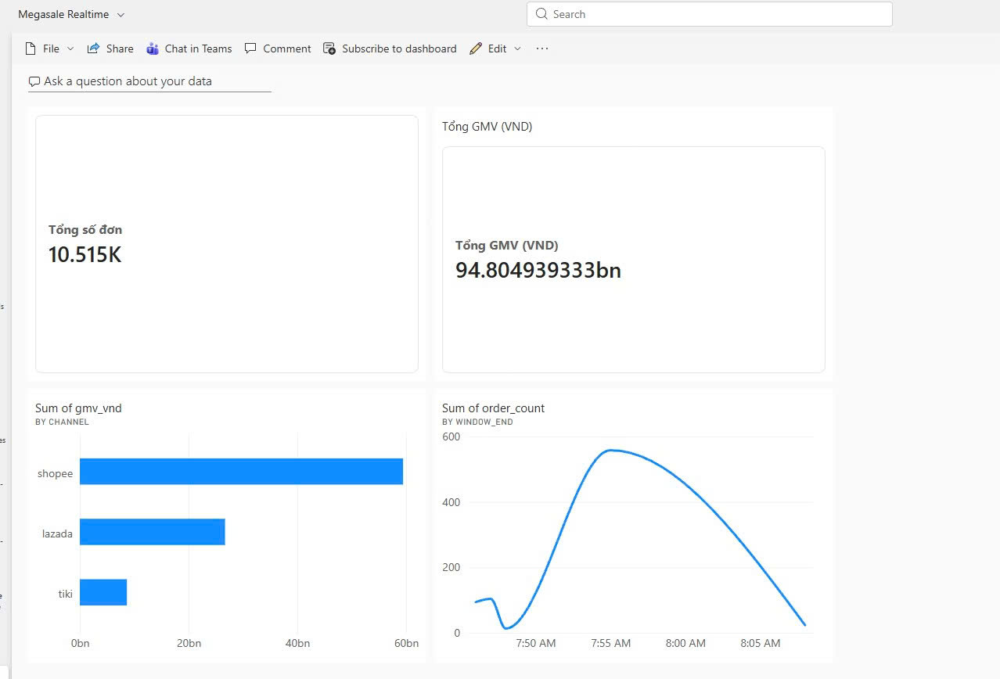

Hình 4.5: Dashboard Megasale Realtime trước khi tăng tải

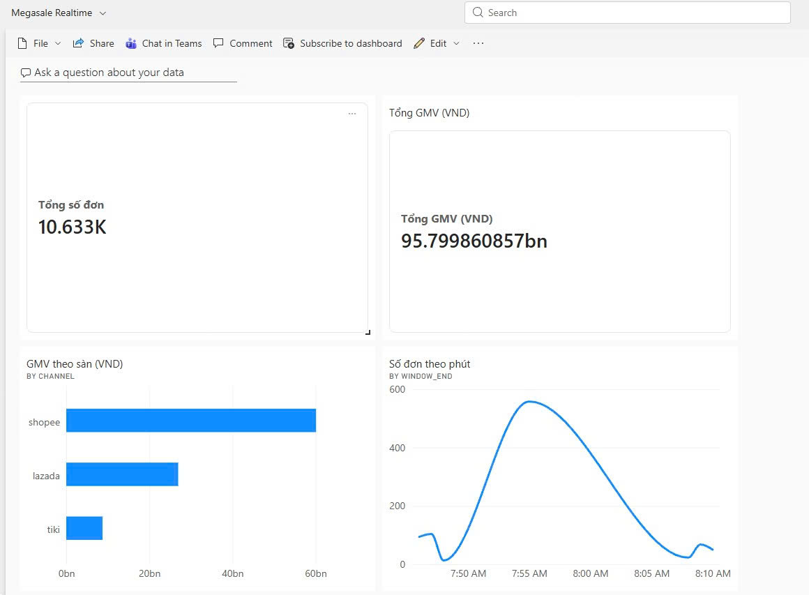

Hình 4.6: Dashboard Megasale Realtime sau khi producer chạy, số liệu đã tăng

Kết quả thử ngày 23/11/2026: khi producer chạy, tile tự tăng mà không cần làm mới trang (Tổng số đơn từ 10.515K lên 10.633K, Tổng GMV từ 94,80 lên 95,80 tỷ đồng). Do Stream Analytics gom theo cửa sổ 1 phút nên số liệu cập nhật theo phút. Trục thời gian hiển thị giờ UTC; giờ Việt Nam bằng UTC cộng 7.

Ghi chú: Microsoft đã thông báo ngừng tính năng real-time streaming của Power BI (mốc 31/10/2027). Tính năng vẫn dùng được cho đồ án này; nếu triển khai lâu dài cần chuyển sang giải pháp thay thế do Microsoft hướng dẫn.

## 4.3 Phân quyền theo dòng dữ liệu (RLS)

RLS được tạo trên semantic model `megasale-report` với sáu vai trò (Bảng 4.2). Mỗi vai trò là một bộ lọc trên bảng chiều nên tự lan sang mọi trang dùng bảng sự kiện.

Bảng 4.2: Các vai trò RLS

| Vai trò | Bảng và cột lọc | Giá trị |
|---|---|---|
| Shopee | `gold dim_channel[channel]` | shopee |
| Tiki | `gold dim_channel[channel]` | tiki |
| Lazada | `gold dim_channel[channel]` | lazada |
| Bac | `gold dim_province[region]` | bac |
| Trung | `gold dim_province[region]` | trung |
| Nam | `gold dim_province[region]` | nam |

Kiểm tra bằng chức năng View as role: cùng một báo cáo nhưng vai trò Shopee chỉ thấy số liệu sàn Shopee (Hình 4.7), vai trò Bac chỉ thấy các tỉnh miền Bắc (Hình 4.8).

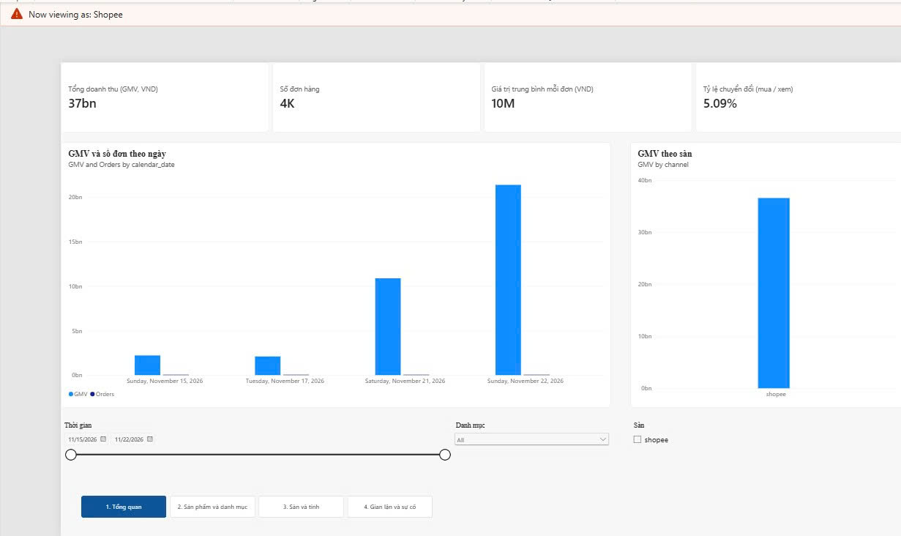

Hình 4.7: Trang 1 khi xem với vai trò Shopee

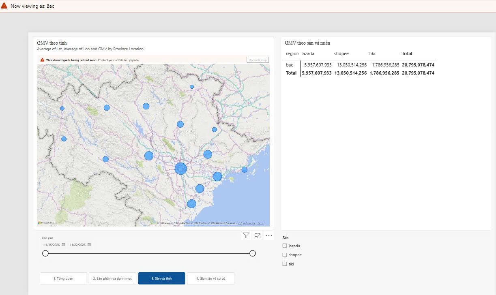

Hình 4.8: Trang 3 khi xem với vai trò Bac (miền Bắc)

Hai tài khoản thật được gán vai trò trong Semantic model, Security: Vũ Ngọc Bảo Thắng thuộc vai trò Shopee, Trần Tuấn Minh thuộc vai trò Tiki (Hình 4.9).

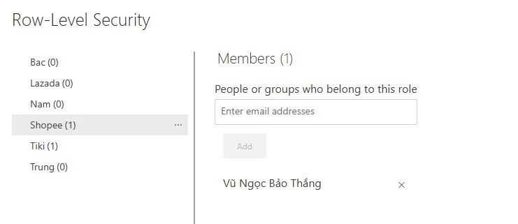

Hình 4.9: Gán thành viên vào vai trò RLS (ví dụ vai trò Shopee)

Hạn chế: (1) RLS chỉ áp cho người có quyền Viewer; quản trị viên, Member và Contributor luôn thấy toàn bộ dữ liệu. (2) Bảng `alerts` không có cột sàn hay miền nên RLS không lọc được, trang 4 luôn hiện toàn bộ cảnh báo.

## 4.4 Chia sẻ bằng Power BI App

Báo cáo `megasale-report` và dashboard "Megasale Realtime" được đóng gói thành Power BI App tên "Megasale Dashboard". Người xem được cấp quyền Viewer trong workspace `Megasale-powerBI` (Hình 4.10) và chỉ xem, không sửa được. Mỗi người xem phải thuộc một vai trò RLS, nếu không sẽ thấy dữ liệu rỗng. App là bản chụp tại thời điểm xuất bản nên sau mỗi lần publish lại báo cáo phải bấm Update app.

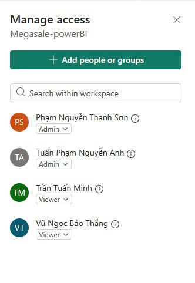

Hình 4.10: Phân quyền trong workspace `Megasale-powerBI`

## 4.5 Bố cục cho điện thoại

Cả bốn trang có bố cục mobile riêng (View, Mobile layout): thẻ số xếp dọc, biểu đồ rộng bằng màn hình, bảng cho vuốt. Đã thử trên ứng dụng Power BI trên điện thoại thật.

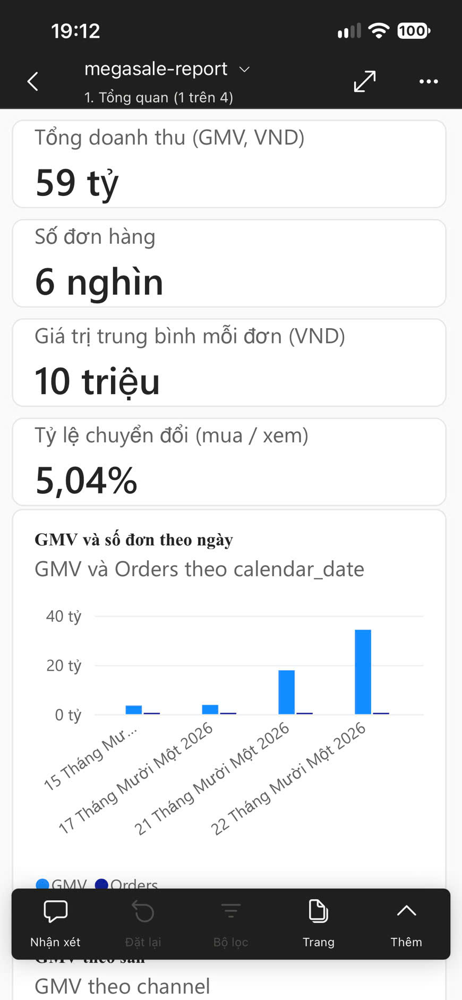 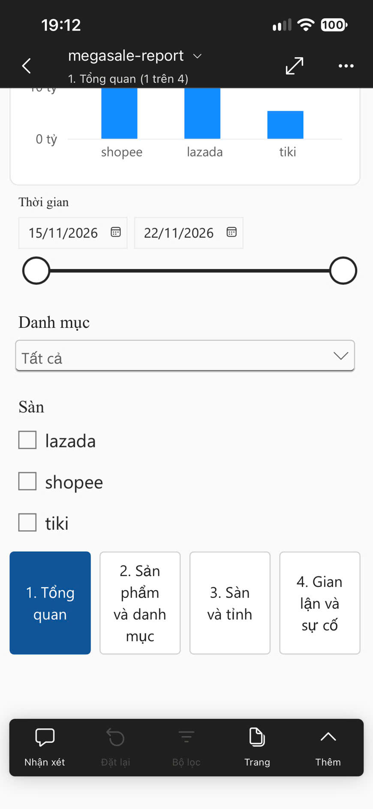 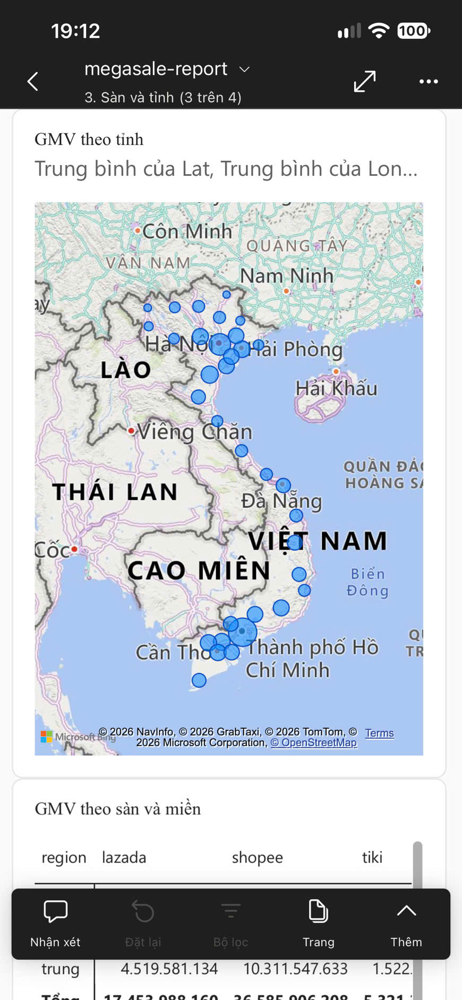 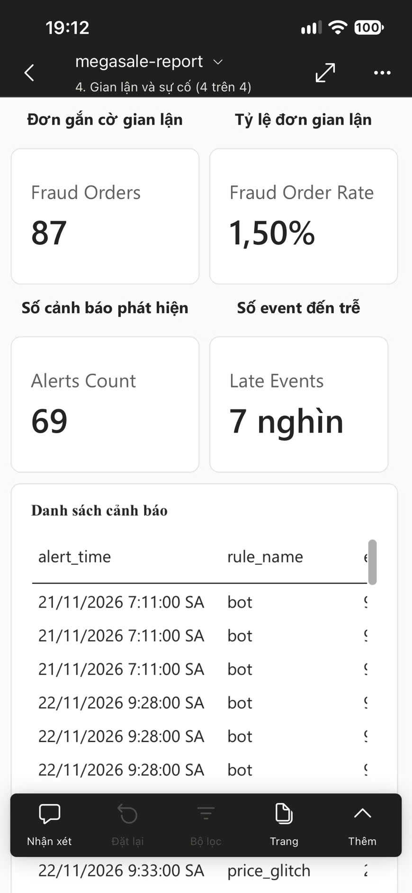

Hình 4.11: Giao diện điện thoại: trang 1 (hai ảnh), trang 3 và trang 4

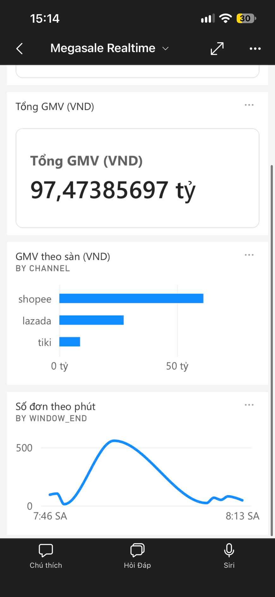

Hình 4.12: Dashboard Megasale Realtime trên điện thoại
